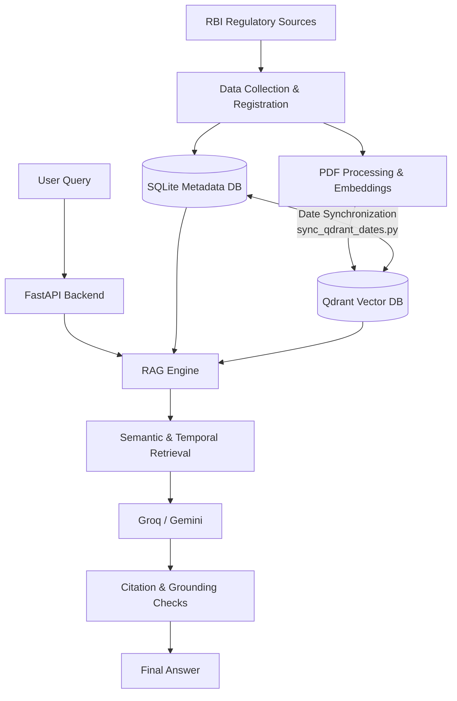

# ArthaOne
### Automated, Temporal RAG-Based Banking & Financial Regulatory Intelligence Platform

ArthaOne is an AI-powered regulatory intelligence platform designed to help users search, understand, and analyse banking and financial regulations using **Retrieval-Augmented Generation (RAG)** and **temporal information retrieval**.

The platform combines semantic search, vector-based document retrieval, structured regulatory metadata, document version management, and Large Language Models (LLMs) to generate context-aware answers grounded in regulatory documents.

Unlike conventional document search systems, ArthaOne incorporates publication dates, effective dates, and document versions to support time-aware regulatory research.

---

## Table of Contents

- [Overview](#overview)
- [Problem Statement](#problem-statement)
- [Key Features](#key-features)
- [System Architecture](#system-architecture)
- [Technology Stack](#technology-stack)
- [How It Works](#how-it-works)
- [Project Structure](#project-structure)
- [Installation and Setup](#installation-and-setup)
- [Example Query](#example-query)
- [Temporal Intelligence](#temporal-intelligence)
- [Current Implementation Status](#current-implementation-status)
- [Future Enhancements](#future-enhancements)
- [Team](#team)

---

## Overview

Financial institutions operate in a constantly evolving regulatory environment. Regulatory authorities periodically publish new circulars, amend existing directions, and introduce provisions that become effective on specific dates.

Finding the correct regulatory information requires more than a simple keyword search. Users must identify relevant documents, understand their provisions, track amendments, and determine which regulations were applicable at a particular point in time.

ArthaOne addresses this challenge through an integrated regulatory intelligence workflow.

The platform enables users to:

- Search regulatory documents using natural-language queries.
- Retrieve semantically relevant regulatory passages.
- Generate AI-assisted answers grounded in retrieved documents.
- Apply temporal filters using publication and effective dates.
- Maintain document and version metadata.
- Compare different versions of regulatory documents.
- Access relevant document and page-level references.

The initial implementation focuses primarily on RBI regulatory documents, with the architecture intended to support broader financial regulatory sources.

---

## Problem Statement

Traditional regulatory research often involves manually searching through large collections of circulars, notifications, and regulatory directions.

Some of the major challenges include:

1. **Information Overload:** Regulatory documents are lengthy and distributed across multiple sources.
2. **Keyword Search Limitations:** Traditional searches may fail to identify relevant provisions when users phrase queries differently from the original documents.
3. **Regulatory Changes:** Amendments and revised directions make it difficult to identify what has changed.
4. **Temporal Ambiguity:** A regulation published on one date may become effective on another date.
5. **Version Tracking:** Comparing previous and current document versions manually is time-consuming.
6. **Answer Reliability:** AI-generated answers need to be supported by relevant regulatory evidence and references.

ArthaOne aims to address these challenges through semantic retrieval, temporal filtering, version comparison, and evidence-grounded answer generation.

---

## Key Features

### 1. Semantic Regulatory Search
- Natural-language querying of regulatory documents.
- Context-based retrieval using sentence embeddings.
- Vector similarity search through Qdrant.
- Retrieval of relevant document passages instead of relying only on keyword matching.

### 2. Temporal Regulatory Search
- Publication-date-based filtering.
- Effective-date-based filtering.
- Historical queries with a specified cutoff date.
- Eligibility filtering to exclude document versions that were not applicable at the requested time.

### 3. Regulatory Document Management
- Structured document metadata storage.
- Document and version identification.
- Source URL and local PDF path management.
- SHA-256 checksums for identifying file-level changes.
- Publication and effective-date tracking.

### 4. Document Version Comparison
- Comparison of different versions of regulatory PDFs.
- Page-level text extraction using PyMuPDF.
- Text normalization before comparison.
- Identification of inserted, deleted, and modified text.
- Page references for examining potential changes.

### 5. AI-Powered Answer Generation
- Integration with LLM providers such as Groq and Google Gemini.
- Context-aware response generation.
- Answers based on retrieved regulatory passages.
- Citation and evidence validation mechanisms.

### 6. Regulatory Change Intelligence
- Identification of potential changes between document versions.
- Change-event tracking for supported regulatory workflows.
- Historical and effective-date-aware change analysis.

*Note: Textual differences are treated as candidate changes and require regulatory interpretation or verification before being considered legally authoritative amendments.*

---

## System Architecture

ArthaOne follows a modular architecture consisting of data collection, document processing, metadata management, vector indexing, retrieval, temporal filtering, and AI-based answer generation.
## System Architecture

## System Architecture

## System Architecture




**Supporting modules:** `compare_versions.py` – document comparison; `sync_qdrant_dates.py` – date synchronization; `test_regulatory_rag.py` – automated testing.

The architecture separates regulatory data collection and indexing from user-query processing. SQLite stores document metadata, while Qdrant stores vector embeddings. The RAG engine combines both to generate temporally relevant, evidence-supported answers.
**Architecture overview:** SQLite manages structured regulatory metadata, while Qdrant stores vector embeddings and associated payloads. The RAG engine combines both sources to retrieve relevant regulatory evidence, apply temporal filters, and generate validated, reference-supported answers.

## Technology Stack

| Category | Technologies |
|---|---|
| Programming Language | Python |
| Backend Framework | FastAPI |
| Database | SQLite |
| Vector Database | Qdrant |
| Embedding Model | Sentence Transformers – `all-MiniLM-L6-v2` |
| PDF Processing | PyMuPDF |
| AI / LLM Integration | Groq, Google Gemini |
| Semantic Retrieval | Vector Similarity Search |
| Text Comparison | Python `difflib` |
| API Testing | Postman / FastAPI Swagger UI |
| Development Environment | Visual Studio Code |

---

## How It Works

### Step 1: Regulatory Data Collection

The data collection pipeline discovers regulatory documents from supported sources, downloads selected PDFs, validates the files, and prepares them for registration.

### Step 2: Metadata Registration

Document information is stored in SQLite, including:

- Document title and regulator.
- Document identifier.
- Version information.
- Publication date.
- Effective date.
- Source URL.
- Local PDF path.
- File checksum.

### Step 3: PDF Processing and Chunking

PyMuPDF extracts text from PDF documents. The extracted content is divided into smaller chunks to make retrieval more efficient.

Overlapping chunks help preserve context across neighbouring text segments.

### Step 4: Embedding Generation

The Sentence Transformers model `all-MiniLM-L6-v2` converts document chunks into numerical vector representations.

These embeddings capture semantic information and allow the system to retrieve passages based on meaning rather than exact keyword matches.

### Step 5: Vector Indexing

Generated embeddings and associated metadata are stored in the Qdrant vector database.

The payload contains relevant information such as document identifiers, version information, dates, page numbers, and source details.

### Step 6: Query Processing and Retrieval

When a user submits a question:

1. The query is processed by the RAG engine.
2. Relevant passages are retrieved from Qdrant.
3. Metadata and document-version eligibility are considered.
4. Temporal filters are applied when a cutoff date is provided.
5. Relevant evidence is prepared for answer generation.

### Step 7: AI Answer Generation

The retrieved passages are supplied to the configured LLM provider.

The model generates a response based on the retrieved regulatory context, with citation and grounding checks applied by the system.

---

## Project Structure

The following is a logical overview of the major project modules. Supporting scripts and data directories may vary across versions.

## Project Structure

## Project Structure

```text
ArthaOne/
│
├── main.py
├── search_circular.py
├── metadata_db.py
│
├── Data Collection/
│   ├── run_rbi_pipeline.py
│   ├── discover_rbi_master_directions.py
│   ├── discover_regulations.py
│   ├── download_regulations.py
│   └── download_one_circular.py
│
├── Document Processing/
│   ├── index_one_document.py
│   └── extract_text.py
│
├── Temporal Intelligence/
│   ├── compare_versions.py
│   ├── sync_qdrant_dates.py
│   └── record_change_event.py
│
├── Testing/
│   └── test_regulatory_rag.py
│
├── data/
│   ├── Regulatory PDFs
│   ├── SQLite Database
│   └── JSON Metadata
│
├── Frontend/
│   └── User Interface Files
│
├── .env.example
├── requirements.txt
└── README.md
```

### Module Overview

| Module | Purpose |
|---|---|
| Core Application | Backend, RAG engine and database operations |
| Data Collection | Discovering and downloading regulatory documents |
| Document Processing | Extracting PDF text, generating embeddings and indexing |
| Temporal Intelligence | Version comparison and date synchronization |
| Testing | Automated testing of RAG functionality |
| Data | Regulatory documents and stored metadata |
| Frontend | User interface |


The project is organized into functional modules covering backend development, regulatory data collection, document indexing, temporal intelligence, testing, storage, and frontend development.

### Main module responsibilities

| Module | Responsibility |
|---|---|
| `main.py` | API and application entry point |
| `search_circular.py` | Retrieval, temporal filtering and LLM responses |
| `metadata_db.py` | Regulatory metadata and version management |
| `run_rbi_pipeline.py` | RBI document collection workflow |
| `index_one_document.py` | PDF indexing and embedding generation |
| `compare_versions.py` | PDF version comparison |
| `sync_qdrant_dates.py` | Synchronizes date metadata with Qdrant |
| `record_change_event.py` | Specialised regulatory change-event processing |
| `test_regulatory_rag.py` | Automated testing |

*The diagram is a logical grouping of the main modules, not an exact representation of the physical folder hierarchy.*

### Important Modules

| File | Responsibility |
|---|---|
| `main.py` | FastAPI backend and API endpoints |
| `search_circular.py` | Core RAG engine, retrieval, temporal filtering, and answer generation |
| `metadata_db.py` | SQLite database and regulatory metadata management |
| `index_one_document.py` | PDF extraction, chunking, embedding generation, and Qdrant indexing |
| `run_rbi_pipeline.py` | RBI document discovery, download, registration, and version comparison coordination |
| `compare_versions.py` | Comparison of different PDF versions |
| `sync_qdrant_dates.py` | Synchronization of temporal metadata between SQLite and Qdrant |
| `record_change_event.py` | Specialised regulatory change-event processing |
| `test_regulatory_rag.py` | Automated tests for important RAG functionality |

---

## Installation and Setup

### Prerequisites

Install the following before running the project:

- Python 3.10 or a compatible version supported by the dependencies.
- pip.
- Git.
- Access to a configured Qdrant instance.
- API credentials for the configured LLM provider.

### 1. Clone the Repository

```bash
git clone <YOUR_REPOSITORY_URL>
```

```bash
cd regulatory-intelligence
```

### 2. Create a Virtual Environment

```bash
python -m venv .venv
```

Activate it on Windows PowerShell:

```powershell
.venv\Scripts\Activate.ps1
```

### 3. Install Dependencies

```bash
pip install -r requirements.txt
```

### 4. Configure Environment Variables

Create a `.env` file in the project root and configure the credentials and connection details required by your implementation.

Example configuration:

```env
GROQ_API_KEY=your_groq_api_key
GEMINI_API_KEY=your_gemini_api_key

QDRANT_URL=your_qdrant_url
QDRANT_API_KEY=your_qdrant_api_key
```

Use only the variables required by your actual configuration. Never commit API keys, passwords, or other secrets to GitHub.

### 5. Initialize the Database

Run the database initialization workflow provided by the project.

If initialization is performed automatically by the application, no separate command is required.

### 6. Start the project

Run the following command from the project root directory in Windows PowerShell:

```powershell
.\.venv\Scripts\python.exe -m uvicorn main:app --reload --port 8000
```

The FastAPI backend will start on:

```text
http://127.0.0.1:8000
```

To access the interactive API documentation:

```text
http://127.0.0.1:8000/docs
```

Keep the terminal running while using the application.

## Example Query

**User Query:**

> Which RBI regulations and circulars related to digital lending were applicable to banks as of 31 December 2024? Summarize the key regulatory requirements and provide the document names, relevant sections, publication dates, and source citations. Exclude any amendments or regulations that became effective after the cutoff date.

**Cutoff Date:** `31 December 2024`

This query evaluates the platform's ability to:

- Understand natural-language regulatory questions.
- Retrieve relevant digital lending provisions.
- Apply temporal filtering.
- Exclude later-effective regulatory changes.
- Generate evidence-based answers.
- Provide document and page-level references where available.

---

## Temporal Intelligence

One of the central components of ArthaOne is its ability to consider the time at which a regulation was published and the time at which it became effective.

These dates are not necessarily identical.

For example:

| Regulatory Event | Date |
|---|---|
| Original circular published | 1 January 2023 |
| Amendment published | 1 July 2024 |
| Amendment becomes effective | 1 October 2024 |
| User's requested cutoff | 31 August 2024 |

For a historical query with a cutoff of 31 August 2024, the system should not treat the amendment as already effective merely because it was published before the cutoff.

The platform uses document-version metadata and temporal eligibility logic to support this distinction.

This helps make historical regulatory research more context-aware.

---

## Current Implementation Status

The project is under active development. The following table distinguishes implemented functionality from areas requiring further validation.

| Component | Status |
|---|---|
| Regulatory document metadata management | Implemented |
| PDF text extraction | Implemented |
| Document chunking and embeddings | Implemented |
| Qdrant vector indexing | Implemented |
| Semantic retrieval | Implemented |
| FastAPI backend integration | Implemented |
| Publication and effective-date metadata | Implemented |
| Temporal filtering | Implemented; requires broader validation |
| Document version management | Implemented |
| PDF version comparison | Implemented |
| LLM-based answer generation | Implemented |
| Citation and grounding validation | Implemented; requires end-to-end validation |
| Regulatory change-event processing | Partially implemented |
| Cross-document comparison | Implemented; further quality improvements needed |

*Implementation status describes the current development state and does not imply that every feature has been validated for production use.*

---

## Future Enhancements

Potential areas for further development include:

- Expanding regulatory coverage across RBI, SEBI, and other financial authorities.
- Improving automated regulatory document monitoring.
- Enhancing amendment detection and change classification.
- Improving historical version reconstruction.
- Strengthening citation verification against original source documents.
- Improving cross-document comparison and relationship mapping.
- Adding more comprehensive temporal retrieval test cases.
- Enhancing the user dashboard with regulatory timelines and change summaries.
- Improving system performance and scalability.

---

## Team


The project involves collaborative development across the following technical areas:

- Regulatory data collection and document processing.
- Backend development and database management.
- Semantic search and vector database integration.
- Temporal intelligence and document version comparison.
- LLM integration, answer validation, and user interface development.

---

## Disclaimer

ArthaOne is an academic and research-oriented regulatory intelligence project.

Its AI-generated responses and identified textual changes are intended to assist regulatory research and should not be treated as legal advice or a substitute for reviewing official regulatory publications.

Users should verify important regulatory interpretations against the original documents issued by the relevant regulatory authority.

---

**ArthaOne — Making Financial Regulatory Information More Searchable, Contextual, and Time-Aware.**
